# Outly

### Find your plans. Find your people.

**Outly помогает занятому взрослому в США превратить «куда бы сходить?» в реальный совместный план:** выбрать событие по интересам, дате и бюджету, найти компанию и сохранить вариант, который нравится обоим.

**Business Cup 2.0 · Entertainment · B2C · Web · Juzcode**
Аудитория: работающие взрослые **25–45 лет**. Интерфейс — **English**. Каталог — **113 проверенных событий и регулярных программ · 61 город · 18 категорий · 50 штатов + Washington DC**.

| Материалы для жюри | Открыть |
| --- | --- |
| **Презентация — PDF, 10 слайдов** | [Outly / Juzcode](docs/pitch/outly-juzcode.pdf) |
| **Публичный исходный код** | [github.com/bsanat/Zimran](https://github.com/bsanat/Zimran) |
| **Production — без регистрации** | **Публичный URL ещё нужно добавить перед отправкой заявки.** `localhost` и скриншоты его не заменяют. |

[Проверить продукт](#проверить-за-5-минут) · [Скриншоты](#продукт-на-экране) · [Критерии жюри](#ответ-на-критерии-жюри) · [Как работает](#как-работает-продукт) · [Запуск](#локальный-запуск) · [Проверки](#проверки-и-текущая-готовность)

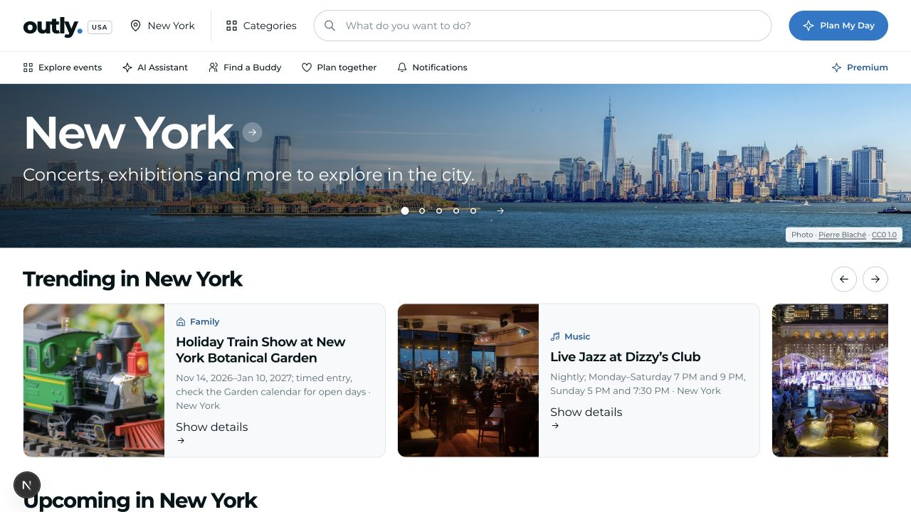

## Один пользователь, одна проблема

Наш стартовый пользователь — работающий человек **25–45 лет в New York**, который недавно переехал или хочет чаще выбираться с другом или партнёром. Вечер и выходные ограничены: нужно найти подходящее событие, понять стоимость и договориться с другим человеком. Списка мероприятий недостаточно, если решение так и не принято.

**Задача пользователя:** «Когда у меня появится свободный вечер, помоги выбрать доступное событие и договориться, с кем туда пойти, чтобы планы не закончились перепиской».

Outly связывает четыре шага: **Discover → Connect → Agree → Return**. Результат — карточка реального события, подтверждённый взаимный выбор и переход на сайт организатора. Покупка билета проходит у организатора.

Почему задача заслуживает проверки: по [American Time Use Survey, 2025](https://www.bls.gov/news.release/archives/atus_06252026.htm), взрослые 35–44 лет в США тратят на досуг и спорт в среднем **3.9 часа в день** — меньше других возрастных групп. Это контекст ограниченного времени; готовность платить именно за Outly мы пока проверяем как гипотезу.

## Проверить за 5 минут

Для полного сценария нужны запущенные **frontend + backend + PostgreSQL**. Для чата дополнительно нужен `GEMINI_API_KEY`; для бесплатной проверки Premium — `DEMO_ENABLED=true`. Вход и банковская карта не требуются.

| Шаг | Что сделать | Что должно произойти |
| --- | --- | --- |
| **1. Найти событие** | На `/explore` выберите **New York → New York → Games → Free only**, дату оставьте пустой. Нажмите **Find events**. | Появится `Thursday Chess at Franklin Park`. Это реальная регулярная программа; неизвестные цены не попадают в бесплатные события. |
| **2. Проверить источник** | Откройте карточку, затем **View event website**. | Откроются детали и HTTPS-ссылка организатора. У события без подтверждённого времени нет выдуманного времени начала. |
| **3. Спросить помощника** | На `/assistant` отправьте `NYC, free games this Thursday`. Затем уточните бюджет или интерес. | При настроенном Gemini — уточнение недостающих условий или до пяти реальных событий. При отсутствии совпадений — пустой результат с предложением изменить условия. |
| **4. Выбрать вдвоём** | На `/pair/new` оставьте **New York, Games, Any time**, даты — ближайшие **7 дней**. Создайте приглашение, откройте **Open partner's window**, присоединитесь с теми же условиями. | Во второй вкладке — независимый участник B. Нажмите **Like** на одном событии в обеих вкладках: появится **Your shared plan / MATCHED**. Выбор сохраняется после обновления. |
| **5. Повод вернуться** | На `/premium` включите **Try Premium Demo**. В `/settings/alerts` выберите **New York, Music, Instant**, бюджет оставьте пустым, сохраните. На `/notifications` нажмите **Check new events**. | Появится подходящее демо-уведомление. Повторная проверка не создаёт дубль; **Mark as read** уменьшает число непрочитанных. |

**Buddy:** после включения Premium Demo откройте событие → **Find someone to join me**, подтвердите 18+ и создайте заявку. Во второй независимой гостевой сессии включите Demo, откройте то же событие и отправьте отклик; автор может принять или отклонить его. Создание заявки и отклик требуют Premium, просмотр и Report/Block доступны бесплатно.

Даты в примерах относительные: календарь New York и наличие событий меняются. Встроенный каталог — подборка, поэтому не каждое сочетание города, категории и даты даст результат. Если AI недоступен, каталог и Pair можно проверить независимо от него.

## Продукт на экране

Скриншоты сняты с работающего локального приложения **15 ноября 2026 года**. Они показывают состояние интерфейса, а не подтверждают доступность production.

| Каталог с фильтрами | Детали и официальный источник |
| --- | --- |
| 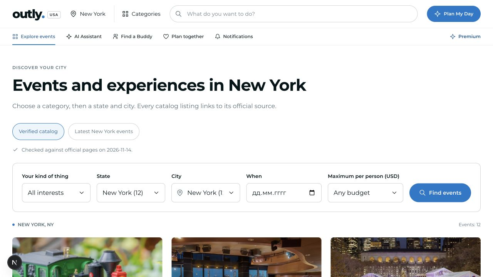 | 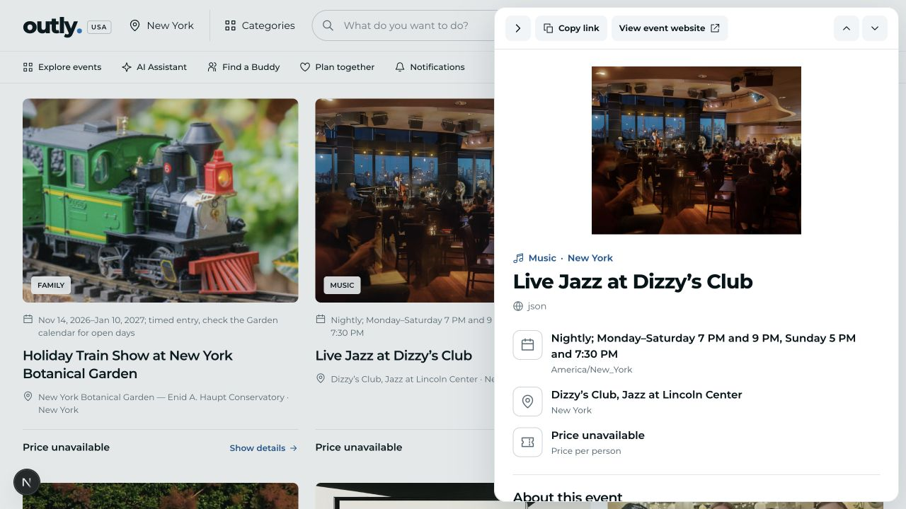 |

<details>
<summary><strong>Совместный выбор, Premium, уведомления и AI-интерфейс</strong></summary>

**Pair Planning:** две отдельные гостевые роли поставили Like на одном событии. Сервер сохранил взаимный выбор.

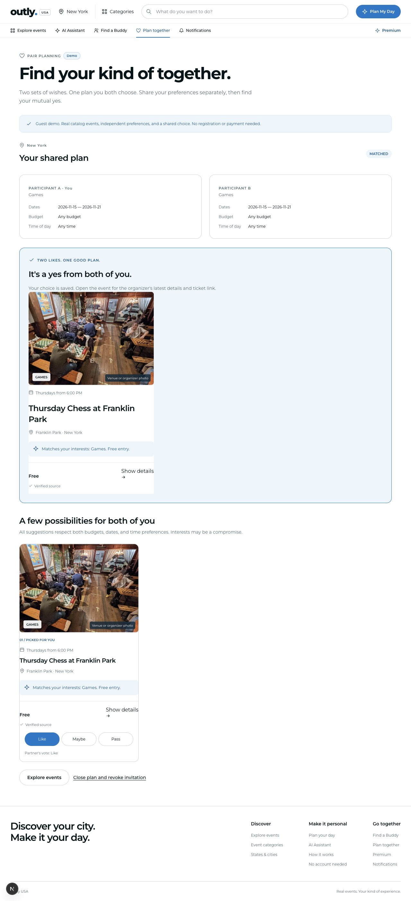

| Premium — гипотеза $4.99/месяц | Персональные оповещения |
| --- | --- |
| 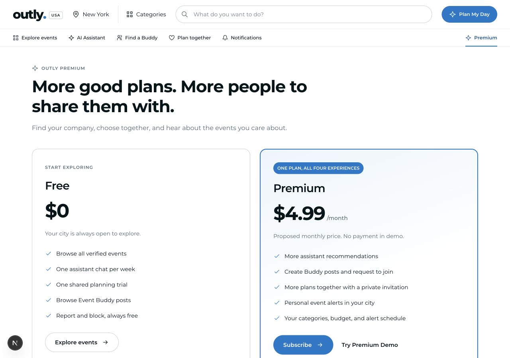 | 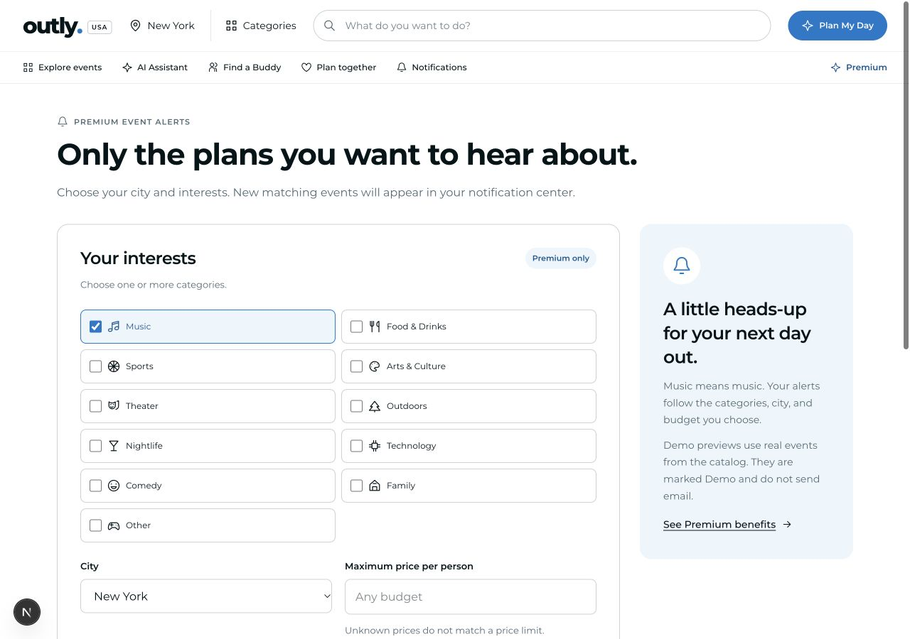 |

**AI Assistant:** проверен реальный запрос `NYC, free games this Thursday`. Gemini разобрал условия, сервер вернул бесплатную программу `Thursday Chess at Franklin Park` с переходом к организатору.

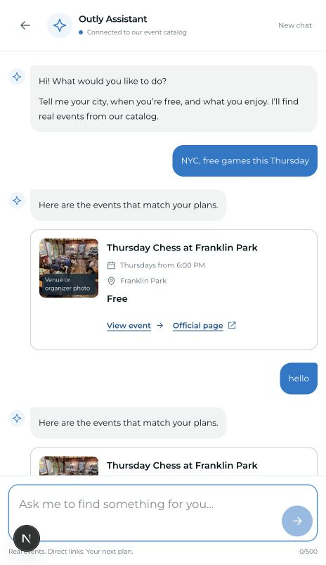

| Event Buddy — выбор события и гостевая лента | Мобильная главная, 390 px |
| --- | --- |
| 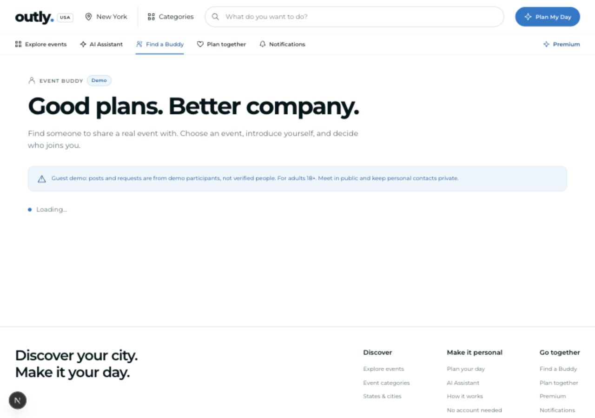 | 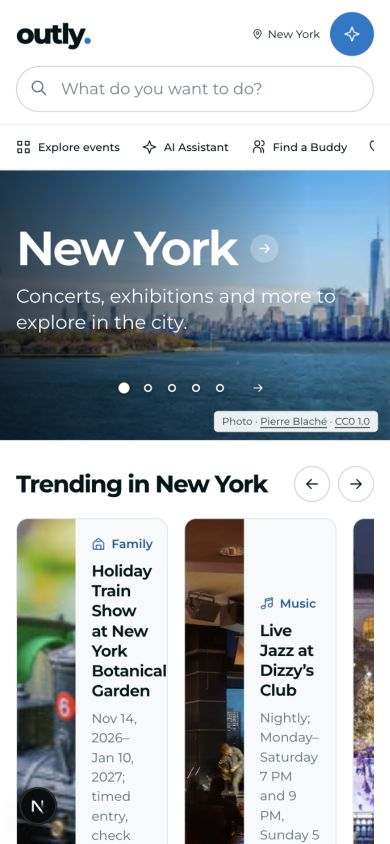 |

</details>

## Ответ на критерии жюри

Веса и требования взяты из предоставленного [брифа Business Cup](docs/brief/judging-criteria.png). Каждая строка указывает результат и способ его проверить.

| Вес | Критерий | Ответ Outly | Доказательство |
| --- | --- | --- | --- |
| **40%** | **Product & Engineering — Does it work?** | Один гостевой путь: фильтры → реальное событие → независимые предпочтения двух людей → взаимный выбор в БД. Ошибки и пустая выдача обрабатываются явно. | [Сценарий проверки](#проверить-за-5-минут), [живые скриншоты](#продукт-на-экране), [API-контроллеры](backend/src/main/java/kz/astyq/zimran), [frontend-тесты](frontend/tests). Публичный production ещё нужно подтвердить. |
| **20%** | **Value & Retention — What do we sell?** | Подписка на помощь с повторяющимся выбором досуга: AI-подбор, Buddy, совместные планы и интересующие события. Возврат — следующий выход и персональное уведомление. | [Состав доступа и цена](#бизнес-модель-и-возврат-пользователя), [Pair](backend/src/main/java/kz/astyq/zimran/pair), [Alerts](backend/src/main/java/kz/astyq/zimran/alert). Платежи и retention пока не подтверждены. |
| **15%** | **Problem & User — Who do we sell to?** | Работающий взрослый 25–45 лет в США; первый сегмент — жители New York, которым трудно превратить свободный вечер в согласованный выход. | [Проблема и задача пользователя](#один-пользователь-одна-проблема), слайды 2–3 [презентации](docs/pitch/outly-juzcode.pdf). |
| **15%** | **Business Potential — Why does it make money?** | B2C-подписка $4.99/месяц, старт в одном городе, рост через приглашения и повторные планы. Экономика и путь к $100M+ ARR представлены с явными допущениями. | [Рынок, экономика и план проверки](#рынок-экономика-и-проверка-гипотез). Выручка, CAC и LTV не заявляются как достигнутые. |
| **10%** | **Originality — Is it new?** | Связка одного события с поиском компании и взаимным решением. Pair применяет общие жёсткие ограничения и сохраняет результат двух голосов, а не только показывает рекомендации. | [Pair matching](backend/src/main/java/kz/astyq/zimran/pair/service/impl/PairMatchingServiceImpl.java), [Buddy](backend/src/main/java/kz/astyq/zimran/buddy), [сценарий MATCHED](frontend/docs/screenshots/jury-pair-match.jpg). |

**Формальные условия:** B2C, браузерный web-продукт, аудитория США 25–45 лет. По [правилам подачи](docs/brief/submission-requirements.png) обязательны все три материала: PDF до 10 слайдов, публичный production без регистрации и публичный GitHub. PDF и репозиторий доступны; production URL нужно добавить в таблицу в начале README.

## Как работает продукт

### 1. Реальные события и фильтрация

[Проверенный JSON-каталог](frontend/src/data/catalog.json) содержит **113 записей**, **61 город**, **18 категорий**, **50 штатов и Washington DC**. Источники проверены **14 ноября 2026 года**. Это число записей, включая регулярные программы, а не обещание 113 доступных мероприятий на любую дату и не полная база США.

В каждой записи есть официальный URL, `lastVerifiedAt`, основание проверки и источник изображения. Фото находятся в `frontend/public/catalog`; фото площадки или прошлой программы в данных отмечены как иллюстрации. В режиме Spring API может отдавать HTTPS-ссылку на оригинал изображения.

Backend нормализует JSON и сохраняет события в PostgreSQL. При первом обращении к пустому городу каталог загружается; последующие запросы читают БД. Плановое обновление включено по умолчанию раз в **15 минут**. `EVENT_INGESTION_ENABLED=false` отключает его: изменение JSON само по себе не обновит уже импортированные строки. Кэш чтения feed — отдельный механизм.

Фильтры учитывают город, категорию, даты, бюджет, статус и подтверждённое расписание: дни недели, сезонные диапазоны и исключения. **Неизвестная цена не равна бесплатной**. Записи без точного времени не получают выдуманное время и не подходят под конкретное время суток.

### 2. AI выбирает из кандидатов

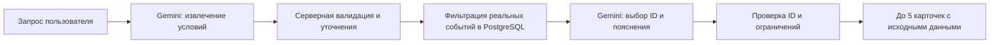

Gemini разбирает свободный текст и ранжирует переданные сервером реальные кандидаты. Сервер проверяет результат: модель не создаёт названия событий, цены, даты или адреса. Backend хранит идентификатор разговора, срок действия и счётчик результатов; интерфейс передаёт текущие предпочтения с каждым сообщением и сохраняет историю вкладки в `sessionStorage`.

`/api/ai/chat`, `/parse` и `/recommend` требуют работающего Gemini. Если ключ не настроен, чат возвращает ошибку доступности AI. **Четырёхшаговый Planner `/api/plan` имеет ранжирование по правилам при недоступности AI; это отдельный сценарий.** Pair также может использовать шаблонные пояснения. Проверка входных данных и выбор реальных ID выполняются сервером в обоих случаях.

### 3. Два человека — одно решение

Pair создаёт одноразовое приглашение на **48 часов**. Участник B открывает его в отдельной вкладке или браузере и вводит свои условия. Сервер использует пересечение дат и времени, меньший из двух бюджетов и реальные события. Интересы могут быть компромиссом; отсутствие совместимых вариантов возвращается явно. Диапазон — до **7 дней включительно**.

Каждый участник голосует **Like / Maybe / Pass**. Два Like на одном событии дают `MATCHED` и сохраняют общий выбор. Токен приглашения передаётся в URL-фрагменте; гостевые роли и доступ к плану проверяются сервером. Закрытие плана отзывает приглашение.

Buddy привязан к конкретному событию: заявка → отклик → решение автора. Есть подтверждение 18+, запрет публичных контактов, Report и Block. Гостевая сессия не означает проверенную личность; наличие реального сообщества пользователей пока не заявляется.

### 4. Уведомления возвращают к продукту

Пользователь сохраняет город, категории, бюджет и частоту. После импорта новых событий backend сопоставляет их с предпочтениями и создаёт уведомления без дублей. **Instant** доступно сразу, **Daily** — с ближайшего следующего окна 09:00, **Weekly** — с ближайшего следующего понедельника 09:00 по часовому поясу города.

Доставка сейчас **in-app**: интерфейс запрашивает список и счётчик, сохраняет прочтение. Email и push не подключены. Кнопка **Check new events** — отдельная проверка Demo с явной маркировкой, а не симуляция продажи билетов.

## Бизнес-модель и возврат пользователя

**Outly Plus в презентации / Premium в интерфейсе — $4.99 в месяц, проверяемая ценовая гипотеза.** Деньги в MVP не списываются; Demo не включает платёжную подписку или автопродление.

| Free | Premium Demo показывает платную ценность |
| --- | --- |
| Каталог, детали и переход к организатору | Дополнительные AI-разговоры — до **30 новых успешных чатов/сутки** |
| Один успешный AI-чат за 7 дней | Создание Buddy-заявок и отклики |
| Один пробный Pair-план | До **20 новых Pair-планов/сутки** |
| Просмотр Buddy, Report и Block | Персональные in-app оповещения |

Один AI-разговор живёт до 24 часов и допускает до 30 результатов; уточнение внутри него не расходует новую недельную попытку. Лимиты — настройки backend и проверяются на сервере. При изменении серверной цены требуется перезапуск/новая сборка backend.

**Почему вернутся:** первая подборка помогает принять решение, Pair приглашает второго пользователя, сохранённые интересы и новые события дают повод запланировать следующий выход. Это реализованные механизмы возврата; рост аудитории, удержание и готовность платить ещё нужно измерить.

### Рынок, экономика и проверка гипотез

В США уже существует потребительская статья расходов на развлечения: по [BLS Consumer Expenditures, 2025](https://www.bls.gov/news.release/cesan.nr0.htm), средние годовые расходы на Entertainment составили **$4,084 на consumer unit**, на **13.2%** выше 2024 года в номинальном выражении. Категория шире событий и Outly: это контекст рынка, не наш TAM и не доказательство спроса на подписку.

Стартуем с одного города и одного сценария — **«план на ближайшую неделю в New York»**. Сначала проверим активацию и повторные планы, затем расширяем плотность событий и число городов. Каналы для экспериментов: локальные сообщества по интересам, поиск по городским событиям и приглашения в Pair.

| Что проверяем после MVP | Как измерять |
| --- | --- |
| Полезность первого сеанса | Доля новых пользователей, открывших релевантное событие и источник или достигших взаимного выбора |
| Повторная потребность | Возврат через 7/30 дней, повторные планы и реакции на уведомления |
| Платёжная ценность | Конверсия из пробного доступа в реальную оплату после подключения платежей |
| Жизнеспособность модели | CAC платящего пользователя, валовая маржа и месячный отток |

**Пример unit economics, все значения — допущения:** цена $4.99/месяц, валовая маржа 80%, месячный отток 5%, CAC $20. Тогда упрощённый LTV ≈ `$4.99 × 0.8 / 0.05` = **$79.84**, LTV/CAC ≈ **4.0**, окупаемость CAC ≈ **5.0 месяцев**. В марже нужно учесть AI, данные, инфраструктуру и поддержку. Это целевой сценарий для проверки, не фактические показатели.

**Путь к $100M+ ARR:** 2 млн платящих пользователей × $4.99 × 12 = **$119.76 млн ARR**. Это арифметика масштаба подписки, не прогноз и не заявленная выручка. Переход к такому масштабу требует подтверждённых удержания, оплаты и повторяемого привлечения в нескольких городах.

## Архитектура и код

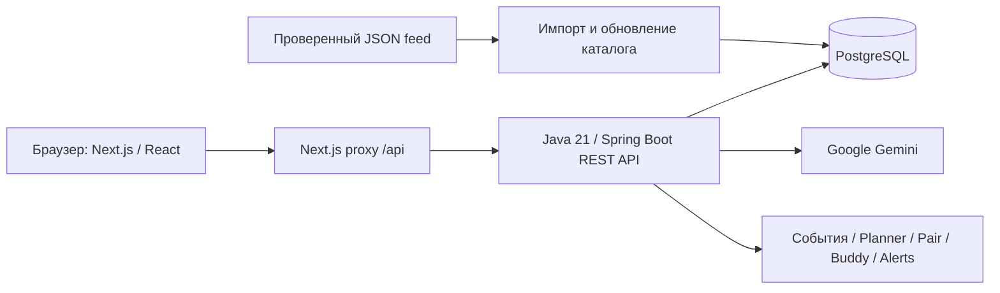

**Frontend:** Next.js 16 App Router, React, TypeScript, Tailwind CSS 4. **Backend:** Java 21, Spring Boot 4, JPA, Bean Validation, Flyway, PostgreSQL. База хранит каталог, гостевые scope, права и лимиты, метаданные разговоров, Pair, Buddy, настройки и прочтение уведомлений, жалобы и блокировки. Гостевой токен проверяется сервером; аккаунт для демо не нужен.

| Область | Исходный код |
| --- | --- |
| UI, состояния загрузки/ошибок, адаптивные страницы | [frontend/src/components](frontend/src/components), [frontend/src/app](frontend/src/app) |
| HTTP-контракты и гостевой клиент | [types](frontend/src/types), [backend-api.ts](frontend/src/lib/backend-api.ts) |
| Серверное подключение к Spring | [next.config.ts](frontend/next.config.ts) |
| Нормализация источника и постоянный каталог | [jsonsource](backend/src/main/java/kz/astyq/zimran/jsonsource), [event](backend/src/main/java/kz/astyq/zimran/event) |
| Разбор запроса, контекст и AI-ранжирование | [assistant](backend/src/main/java/kz/astyq/zimran/assistant), [ai](backend/src/main/java/kz/astyq/zimran/ai) |
| Совместные планы и поиск компании | [pair](backend/src/main/java/kz/astyq/zimran/pair), [buddy](backend/src/main/java/kz/astyq/zimran/buddy) |
| Оповещения и окна доставки | [alert](backend/src/main/java/kz/astyq/zimran/alert), [notification](backend/src/main/java/kz/astyq/zimran/notification) |
| Схема БД и настройки цены/квот | [миграции Flyway](backend/src/main/resources/db/migration), [application.yml](backend/src/main/resources/application.yml) |

### Основной HTTP API

| Метод / маршрут | Назначение |
| --- | --- |
| `GET /api/health`, `GET /api/meta` | Доступность API, города, категории и метаданные |
| `GET /api/events`, `GET /api/events/{id}` | Поиск и детали; ID кодируется через `encodeURIComponent` |
| `POST /api/guest/session` | Гостевой scope и токен доступа к персональным действиям |
| `POST /api/ai/chat`, `/api/ai/parse`, `/api/ai/recommend` | Диалог, извлечение условий и рекомендации из кандидатов |
| `POST /api/plan` | До пяти рекомендаций Planner; fallback при недоступности AI |
| `POST /api/pair/sessions`, `/api/pair/join` | Приглашение и присоединение второго участника |
| `GET /api/pair/{id}`, `POST /api/pair/{id}/votes`, `POST /api/pair/{id}/revoke` | Состояние, голоса и закрытие плана |
| `/api/buddy/posts`, `/api/buddy/me`, `/api/buddy/requests/*` | Заявки, отклики, принятие/отмена и история пользователя |
| `GET/PUT /api/alerts/preferences`, `GET /api/notifications` | Предпочтения и личный список уведомлений |
| `PATCH /api/notifications/{id}/read`, `POST /api/notifications/read-all` | Сохранение прочтения |
| `GET /api/subscription`, `POST/DELETE /api/demo/premium` | План доступа и включение/выключение Premium Demo |
| `POST /api/reports`, `/api/blocks` | Жалобы и блокировки |

Каталог отвечает `{ events, pagination }`, детали — `{ event }`, ошибки — `{ error: { code, message, details, requestId } }`. Даты — `YYYY-MM-DD`, `startDate`/`endDate` включительно; время отображается в часовом поясе события. Персональные запросы используют `X-Guest-Token`; чтение Pair, голосование и отзыв — выданный участнику `X-Pair-Token`. Полный контракт запущенного backend: `/swagger-ui/index.html` и `/v3/api-docs`.

## Локальный запуск

Нужны **Node.js 24+**, npm, **JDK 21**, Docker с Compose. Секреты задаются только на сервере. Значения по умолчанию БД в конфигурации совпадают с локальным Compose.

```sh
git clone https://github.com/bsanat/Zimran.git
cd Zimran
```

**Терминал 1 — backend и PostgreSQL:**

```sh
cd backend
docker compose up -d --wait postgres
# Для AI задайте свой ключ в окружении этого терминала/IDE, не в Git:
export GEMINI_API_KEY='your-gemini-api-key'
DEMO_ENABLED=true sh ./mvnw -Dmaven.test.skip=true spring-boot:run
```

Backend: [http://localhost:8080/api/health](http://localhost:8080/api/health). `EVENTS_JSON_SOURCE` по умолчанию указывает на `../frontend/src/data/catalog.json`; packaged Docker-версия использует свой путь. Примеры имён переменных: [backend/.env.example](backend/.env.example). **Spring не загружает `backend/.env` автоматически** — экспортируйте значения или задайте их в run configuration. При другом порте БД укажите `DB_URL`, `DB_USERNAME`, `DB_PASSWORD`.

`DEMO_ENABLED=true` включает бесплатную активацию Premium и может добавить явно обозначенные **вымышленные `demo:*` события** для проверки механик. Они не входят в 113 проверенных записей JSON. Для каталога без этих примеров запускайте с `DEMO_ENABLED=false`; кнопка Premium Demo тогда недоступна.

**Терминал 2 — frontend:**

```sh
cd frontend
npm ci
API_PROXY_ORIGIN=http://localhost:8080 npm run dev
```

Откройте [http://localhost:3000](http://localhost:3000). В production значения `API_PROXY_ORIGIN` должны быть настроены для Next.js; `NEXT_PUBLIC_API_BASE_URL` оставьте пустым при использовании proxy. Для прямых браузерных запросов к отдельному API нужен корректный `CORS_ALLOWED_ORIGINS`. После изменения env перезапустите соответствующий сервер.

**Без Gemini-ключа:** каталог, детали, Pair и Planner с fallback работают; AI-чат сообщает о недоступности модели. **Только frontend без Spring:** доступен локальный каталог и детали; текущие Assistant, Pair, Buddy, Premium и Alerts требуют backend. SerpApi (`SERPAPI_KEY` или `API_KEY`) — отдельный встроенный live-режим frontend. Наличие старых Next demo API не означает, что нынешний UI использует их вместо Spring.

Frontend для production собирается через `npm run build`, запускается через `npm start`. Для постоянных гостевых сессий на нескольких backend-инстансах задайте одинаковый надёжный `GUEST_TOKEN_SECRET`; пустое значение генерирует временный ключ процесса для разработки.

## Проверки и текущая готовность

Проверка исходников и локального приложения: **15 ноября 2026 года**. Скриншоты и результаты ниже относятся к локальному запуску, не к опубликованному production.

| Проверка | Результат |
| --- | --- |
| Frontend unit/API-тесты | **89/89 прошли** после исправлений ссылок и цены. |
| TypeScript | `npm run typecheck` — прошёл после финальных правок. |
| Каталог и детали через Spring | В браузере открыты реальные события New York; HTTPS-ссылка организатора проверена. |
| Pair, две отдельные роли | Созданы приглашение и участник B; два Like дали подтверждённый сервером `MATCHED`. |
| AI-чат | Gemini-ключ подключён через окружение Java-процесса. В браузере запрос `NYC, free games this Thursday` вернул реальное бесплатное событие и официальный источник; [скриншот](frontend/docs/screenshots/jury-assistant.jpg). |
| Premium / Buddy / Alerts | Цена $4.99 проверена в интерфейсе и backend API (`499` центов); текущий сервер запущен с `DEMO_ENABLED=false`, поэтому полная активация Premium и создание уведомления в этом браузерном прогоне не заявляются. |
| Мобильный экран | Главная проверена на 390 px: горизонтального переполнения страницы нет; [скриншот](frontend/docs/screenshots/jury-home-mobile.jpg). |
| Production | Публичный URL не предоставлен; доступность с чистого браузера ещё нужно проверить. |

Чтобы воспроизвести проверки frontend:

```sh
cd frontend
npm test
npm run typecheck
```

В тестах проверяются валидация и бюджет, календарные исключения, корректность API-ответов, выбор реальных ID, восстановление контекста, лимиты и независимость гостевых ролей, взаимные голоса и дедупликация уведомлений. Часть тестов относится к встроенному legacy API, а не к Spring; их успех не заменяет проверку интегрированного продукта. Java-тесты и production build frontend в рамках обновления README не запускались. После подключения Gemini backend скомпилирован без запуска тестов, перезапущен на той же локальной БД; `/api/health` вернул HTTP 200.

### Границы MVP и следующие шаги

- **Готово в коде:** проверенный каталог, серверная фильтрация, AI-интеграция с валидацией, Planner fallback, Pair и Buddy с серверным состоянием, in-app уведомления, постоянное хранение в PostgreSQL.
- **Нужно для подачи:** добавить production URL, настроить серверные env в production и пройти полный сценарий в публичном браузере без входа; PDF и GitHub уже указаны в начале README.
- **Нужно для платного продукта:** подключить платежи, проверить ценовую гипотезу и удержание, добавить постоянные аккаунты и восстановление доступа, развивать модерацию и качество обновления событий. Email/push, проверка личности и действующее сообщество не заявляются как реализованные.

## Команда Juzcode

**Sanat Bogenbayev · Oralkhan Seilkhan · Adilov Nurkeldi**

Business Cup 2.0 · 14–15 ноября 2026 · Назарбаев Университет.
**Outly — от идеи выйти из дома к плану, на который согласились.**
