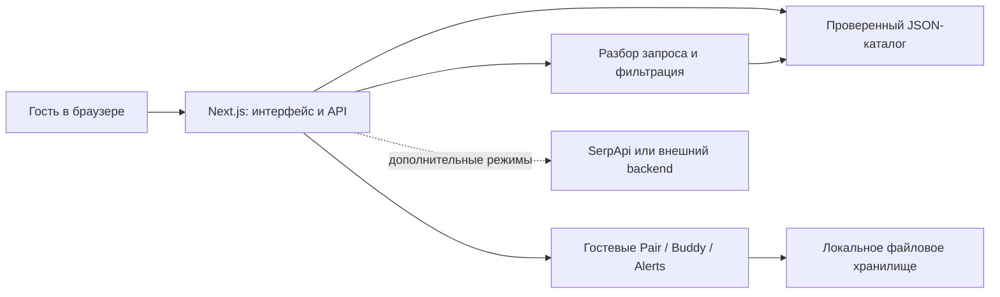

# Outly

### Меньше планирования. Больше жизни в городе.

**Outly помогает занятому человеку в США выбрать реальное событие, найти компанию и договориться о совместном выходе.** Пользователь получает несколько подходящих вариантов с датами, бюджетом и переходом к организатору.

**Business Cup 2.0 · Entertainment · B2C · Web · Команда Juzcode**


[Проблема и пользователь](#для-кого-и-зачем) · [Проверить продукт](#проверить-за-3-минуты) · [Критерии жюри](#как-проект-соответствует-критериям) · [Запуск](#быстрый-запуск) · [Архитектура](#как-это-устроено)

| Материал для жюри | Ссылка / статус |
| --- | --- |
| Production — открыть без регистрации | **Команда добавит URL перед отправкой** |
| Pitch deck — до 10 слайдов | **Команда добавит ссылку на PDF перед отправкой** |
| Исходный код | [github.com/bsanat/Zimran](https://github.com/bsanat/Zimran) |

## Для кого и зачем

Наш основной пользователь — работающий взрослый **25–45 лет в США**, которому хочется интереснее проводить свободное время, но трудно выбрать подходящее событие и согласовать выход с другим человеком. Стартовый сценарий — человек, который недавно переехал в город и ещё не нашёл привычные места и компанию.

Проблема возникает до покупки билета: нужно сопоставить интересы, расписание, стоимость и предпочтения другого человека. Outly собирает этот выбор в один путь:

> «Хочу куда-нибудь в четверг, бесплатно, люблю настольные игры» → подходящее реальное событие → детали и официальный сайт → компания или совместный выбор.

Это выбранная продуктовая гипотеза. Исследование готовности платить и показатели удержания ещё предстоит подтвердить на пользователях.

## Что можно сделать в MVP

| Сценарий | Что получает пользователь | Где открыть |
| --- | --- | --- |
| **Найти событие** | Каталог с фильтрами города, категории, даты и бюджета; фото, детали и официальный источник | `/explore` |
| **Описать желание словами** | Чат уточняет условия и показывает до пяти подходящих событий со ссылками прямо в ответе | `/assistant` |
| **Найти компанию** | Заявка к конкретному событию, отклик и принятие участника; жалобы и блокировки | `/buddy` — гостевое демо |
| **Выбрать вдвоём** | Приглашение, отдельные предпочтения двух участников и сохранённый взаимный выбор | `/pair/new` — гостевое демо |
| **Вернуться за новым планом** | Настройки интересов и in-app уведомления о совпадениях | `/settings/alerts`, `/notifications` — демо-лента |

Все эти страницы доступны без регистрации. Для проверки расширенных сценариев есть **Try Premium Demo** на `/premium`: карта и оплата не нужны. Интерфейс доступен на **русском, английском и казахском**; тексты событий сохраняют язык первоисточника.

### Реальные данные, проверяемая выдача

В каталоге **113 событий и регулярных программ, 61 город, 18 категорий, все 50 штатов и Washington DC**. Это число записей, а не обещание 113 мероприятий на любую выбранную дату. Дата проверки источников — **14 ноября 2026 года**.

- У каждой записи есть официальный URL, дата проверки и основание включения. [Открыть каталог](frontend/src/data/catalog.json).
- Фильтры и подбор выполняются при запросе; ответ не подменяется заранее подготовленной подборкой.
- Неизвестная цена не считается бесплатной. Фильтр бюджета в каталоге работает с известной ценой в USD.
- Календарь учитывает подтверждённые даты, дни недели, сезонность и исключения. Время для записей без времени не придумывается.
- Фотографии хранятся локально; источник записан в данных. Фото площадки или прошлой программы отмечено как иллюстрация.

Источники и состав последнего пополнения: [31 новая запись по городам](frontend/docs/catalog-expansion.md). Наличие билетов и изменения расписания нужно проверять у организатора.

## Проверить за 3 минуты

Сначала запустите приложение по инструкции ниже или откройте production-ссылку после её добавления. Названия кнопок здесь указаны на английском; язык можно сменить в шапке.

| Шаг | Действие | Проверяемый результат |
| --- | --- | --- |
| **1. Каталог** | Откройте `/explore`, выберите штат New York, город New York и Games → **Find events**, без ограничения даты | Реальные карточки; детали открываются, официальная ссылка ведёт к организатору |
| **2. Чат** | На `/assistant` последовательно отправьте `New York`, `games this Thursday`, `free only` | Помощник сохраняет контекст и выдаёт подходящие события со ссылками либо объясняет отсутствие совпадений |
| **3. Общий выбор** | На `/pair/new` задайте New York, Games, ближайшие 30 дней, любое время и бюджет. Создайте приглашение → **Open partner's window** | Во втором окне задайте предпочтения B. Поставьте Like на одной карточке с обеих сторон — взаимный выбор сохранится |
| **4. Повторное использование** | Включите **Try Premium Demo** на `/premium`. Сохраните New York → Games → Instant в `/settings/alerts`, затем нажмите **Check new events** на `/notifications` | Появится уведомление с отметкой Demo. Повторная проверка не создаст дубль; прочтение уменьшит счётчик |

Для проверки Buddy, независимых гостевых сессий, ошибок и ограничений: [подробные сценарии MVP 2.0](frontend/docs/mvp2.md). Пример с относительной датой использует актуальный календарь New York; конкретная выдача может измениться.

## Как проект соответствует критериям

| Критерий Business Cup | Ответ Outly | Что проверить в репозитории |
| --- | --- | --- |
| **40% — Product & Engineering** | Гостевой путь от запроса до реального события, интерактивный выбор вдвоём, обработка ошибок и ограничений | [Серверный подбор](frontend/src/lib/server/assistant.ts), [фильтры каталога](frontend/src/lib/catalog.ts), [гостевые сценарии](frontend/src/lib/server/social.ts), [тесты](frontend/tests) |
| **20% — Value & Retention** | Экономия усилий на выборе; повод вернуться — следующий выход, совместный план и интересующие события | [Пользовательские сценарии](#что-можно-сделать-в-mvp), [гипотеза Premium](#за-что-пользователь-будет-платить) |
| **15% — Problem & User** | Один основной сегмент: занятый взрослый 25–45 лет в США; задача — превратить желание выйти из дома в согласованный план | [Проблема и пользователь](#для-кого-и-зачем) |
| **15% — Business Potential** | B2C-подписка на повторяющуюся потребность; проверяемая модель цены, удержания и привлечения | [Модель и масштаб](#бизнес-модель-и-проверка-гипотез) |
| **10% — Originality** | Связка «что сделать → с кем → что подходит обоим → когда вернуться», привязанная к одним реальным событиям | Assistant → Buddy → Pair → Alerts |

Продукт работает в браузере и ориентирован на B2C. Production URL и pitch deck команда добавляет в таблицу материалов выше: README не заменяет эти два обязательных элемента заявки.

## За что пользователь будет платить

Бесплатный каталог даёт возможность найти и оценить реальные события. **Premium за $9.99 в месяц — гипотеза цены** за регулярную помощь с выбором: больше обращений к помощнику, создание Buddy-заявок, дополнительные совместные планы и персональные уведомления.

| Бесплатный доступ | Premium Demo показывает будущий платный сценарий |
| --- | --- |
| Просмотр проверенного каталога и деталей | До 50 новых чатов помощника в сутки |
| Один успешный чат за 7 дней | Создание Buddy-заявок и отклики |
| Один пробный совместный план | Дополнительные совместные планы |
| Просмотр Buddy-заявок; жалобы и блокировки | Персональные настройки in-app уведомлений |

В одном чате можно уточнять условия: до 30 подборок в течение 24 часов. Доступ и лимиты проверяются сервером. **Платежи, списания и автопродление не подключены**; Premium Demo не подтверждает готовность пользователя платить.

### Бизнес-модель и проверка гипотез

Первый рынок для проверки — один город, New York. Каналы привлечения, которые планируем проверить: поиск по городским событиям, локальные сообщества по интересам и приглашение второго участника в совместный план. Доход предполагается от конечного пользователя, а не от продажи услуги компаниям.

Проверка строится на последовательности: **первый релевантный результат → переход к организатору или взаимный выбор → повторное использование → платная подписка**. Нужно измерить активацию, возврат через 7/30 дней, конверсию в оплату, месячный отток и стоимость привлечения платящего пользователя. Эти метрики пока не заявляются как достигнутые.

**Иллюстрация экономики, не фактические показатели:** при цене $9.99/месяц, валовой марже 80%, месячном оттоке 5% и CAC $30 упрощённый LTV ≈ `$9.99 × 0.8 / 0.05` = **$160**, LTV/CAC ≈ **5.3**, окупаемость привлечения ≈ **3.8 месяца**. Все четыре исходных значения требуют проверки; расходы на данные, AI и поддержку должны входить в расчёт маржи.

**Долгосрочный сценарий масштаба:** 1 млн платящих пользователей × $9.99 × 12 ≈ **$119.9 млн ARR**. Это арифметическая модель для цели $100M+ ARR, а не оценка размера рынка, прогноз или текущая выручка. Следующий шаг — подтвердить удержание и оплату в одном городе до расширения.

## Быстрый запуск

Нужен **Node.js 24+** и npm. Репозиторий состоит из `frontend/` (Next.js) и `backend/` (Java / Spring Boot). Для основного гостевого демо достаточно frontend.

```sh
git clone https://github.com/bsanat/Zimran.git
cd Zimran/frontend
npm ci
npm run dev
```

Откройте **[http://localhost:3000](http://localhost:3000)**. Если этот frontend уже открыт отдельным рабочим каталогом, выполняйте `npm ci` и `npm run dev` прямо в нём.

**Без API-ключей работают:** каталог, локальные фото, чат по каталогу и гостевые социальные демо. В этом режиме `API_PROXY_ORIGIN` и `NEXT_PUBLIC_API_BASE_URL` должны быть пустыми. Гостевым сценариям нужен сервер с доступным для записи локальным диском.

### Дополнительные режимы

| Настройка | Для чего нужна |
| --- | --- |
| `SERPAPI_KEY` или `API_KEY` | Встроенный live-поиск и четырёхшаговый Planner для New York |
| `API_PROXY_ORIGIN` | Серверное подключение внешнего backend; маршрутизация определяется `next.config.ts` и API routes |
| `NEXT_PUBLIC_API_BASE_URL` | Альтернатива: публичный адрес API для прямых запросов браузера; backend должен разрешить CORS |
| `OUTLY_DEMO_DIR` | Отдельный каталог хранения гостевых демо; по умолчанию `.outly-demo/` |

Для настроек используйте `.env.local`; пример — [.env.example](frontend/.env.example). Секреты остаются на сервере, не в `NEXT_PUBLIC_*`. После изменения env перезапустите сервер. **Чат `/assistant` и четырёхшаговый `/planner` — разные сценарии:** встроенный Planner требует SerpApi, чат использует локальный каталог.

Для production-сборки frontend:

```sh
npm run build
npm start
```

### Отдельный backend из этого репозитория

Дополнительно нужны **Java 21** и **Docker Compose** для PostgreSQL. В отдельном терминале из корня репозитория:

```sh
cd backend
docker compose up -d postgres
EVENTS_JSON_SOURCE=../frontend/src/data/catalog.json EVENT_INGESTION_ENABLED=false DEMO_ENABLED=false sh ./mvnw -Dmaven.test.skip=true spring-boot:run
```

Настройки БД по умолчанию совпадают с локальным `docker-compose.yml`. Backend доступен на `http://localhost:8080`; переменные конфигурации описаны в [backend/.env.example](backend/.env.example). OpenAI-ключ нужен для внешнего ранжирования, а не для просмотра frontend-каталога. Для подключения frontend задайте `API_PROXY_ORIGIN=http://localhost:8080` в `frontend/.env.local` и перезапустите Next.js. Гостевые Buddy/Pair/Alerts пока используют встроенный сервер frontend. Запуск Java backend при подготовке этого README не повторялся.

## Как это устроено

**Frontend и встроенный сервер:** Next.js App Router, React, TypeScript, Tailwind CSS 4. Общие типы запроса и события находятся в `src/types`, HTTP-клиент — в `src/lib/api.ts`. Фото, карта и Montserrat хранятся локально.



**Что означает AI Assistant в текущем MVP.** Встроенный чат использует разбор текста по правилам на трёх языках и подбор из каталога. Он не вызывает генеративную модель и не создаёт события. В монорепозитории также есть отдельный Java 21 / Spring Boot / PostgreSQL backend с адаптером OpenAI для ранжирования; это отдельный режим, не основание приписывать LLM локальному чату. Полное объединение гостевых frontend-сценариев с Java backend ещё не завершено.

| Область | Где читать код |
| --- | --- |
| Страницы, детали и состояния интерфейса | [src/app](frontend/src/app), [src/components](frontend/src/components) |
| Данные, география и календарные ограничения | [catalog.json](frontend/src/data/catalog.json), [catalog.ts](frontend/src/lib/catalog.ts) |
| Чат, контекст и выбор реальных ID | [assistant.ts](frontend/src/lib/server/assistant.ts) |
| Гостевые права, парное голосование, Buddy и уведомления | [social.ts](frontend/src/lib/server/social.ts) |
| Live-поиск и встроенный Planner | [serpapi.ts](frontend/src/lib/server/serpapi.ts) |
| Типы и HTTP-клиент | [src/types](frontend/src/types), [api.ts](frontend/src/lib/api.ts) |
| Отдельный Java backend в монорепозитории | [backend/](https://github.com/bsanat/Zimran/tree/main/backend) |

### Основной API

| Метод и путь | Назначение |
| --- | --- |
| `GET /api/events` | Каталог с фильтрами `state`, `city`, `category`, `date`, `budgetMax`, `keyword`, `page`; `source=live` — отдельный режим |
| `GET /api/events/:id` | Детали события; ID кодируется через `encodeURIComponent` |
| `POST /api/ai/chat` | Сообщение, уточнение условий или рекомендации со ссылками |
| `POST /api/plan` | До пяти рекомендаций четырёхшагового Planner |
| `/api/demo/*` | Гостевая сессия, Premium Demo, Buddy, Pair и уведомления |
| `GET /api/health` | Проверка доступности сервиса |

Каталог возвращает `{ events, pagination }`, детали — `{ event }`, ошибки — `{ error: { code, message, ... } }`. Даты планирования — `startDate` / `endDate` включительно, `YYYY-MM-DD`; время события отображается в часовом поясе площадки. [Контракты](frontend/src/types) и [расширенные API-сценарии](frontend/docs/mvp2.md).

## Качество и воспроизводимость

```sh
npm test
npm run typecheck
npm run build
```

**Проверка 14 ноября 2026: 85 frontend-тестов прошли** при подготовке README. В том числе проверяются границы дат, неизвестная цена, фильтры и пагинация, реальные ID рекомендаций, контекст чата, изоляция гостевых ролей, ограничения доступа, взаимный выбор и отсутствие дублей уведомлений. Проверка наличия локальных фото не означает постоянную доступность сайтов организаторов.

Для предыдущего пополнения каталога также прошли TypeScript и production build; через локальный HTTP API проверены 31 новая карточка с изображением и пять сочетаний города/категории. При редактировании README сборка и визуальная проверка не повторялись. Тесты Java backend в эту проверку не входят.

## Границы MVP и следующие шаги

| Сейчас | Что необходимо для следующего этапа |
| --- | --- |
| Проверенный вручную каталог | Автоматическое обновление и контроль устаревших дат, цен и ссылок |
| Гостевые сессии; история в `sessionStorage` вкладки | Постоянный профиль, аутентификация и восстановление доступа |
| Pair/Buddy/Premium сохраняются атомарно в `.outly-demo/state.json` одного сервера | Общая транзакционная БД перед несколькими процессами или serverless-запуском |
| Buddy — взаимодействие двух демо-сессий, с подтверждением 18+ и Report/Block | Проверка личности, модерация и правила безопасного общения; действующее сообщество пока не заявляется |
| Уведомления проверяются вручную по демо-ленте реальных записей | Реальная доставка новых событий по расписанию; email и cron пока не подключены |
| Premium Demo без оплаты | Платёжный провайдер и проверка готовности платить |

При Daily/Weekly уведомление становится доступно через 24 часа/7 дней при обращении к центру уведомлений; фоновой доставки сейчас нет. Email-форма не отправляет письма. Подробности реализации и безопасности гостевых сценариев: [MVP 2.0](frontend/docs/mvp2.md). Дизайн и источники визуальных материалов: [дизайн проекта](frontend/docs/fever-design.md).

## Структура репозитория

```text
frontend/
  src/app/          Страницы и встроенный HTTP API
  src/components/   Интерфейс продукта
  src/data/         Проверенный каталог
  src/lib/          Фильтры, клиент API и серверная логика
  tests/            Автоматические проверки frontend и встроенного API
  docs/             Сценарии MVP, источники данных и дизайн
backend/
  src/main/java/    Spring Boot: API, события, Planner, Pair и уведомления
  src/main/resources/  Конфигурация и миграции Flyway
  docker-compose.yml   PostgreSQL для локального запуска
```

## Команда Juzcode

**Sanat Bogenbayev · Nurkeldi Adilov · Oralkhan Seilkhan**

Business Cup 2.0 · 14–15 ноября 2026 · Назарбаев Университет.
